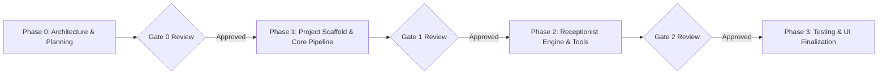

# AgentsMD.md — Standing Agent Rules, Behavior & Workflow Protocol

## 1. Purpose & Authority

This document defines the standing behavior, engineering invariants, workflow protocols, and safety rules for any AI coding agent operating on the **Kyoma** codebase and the forthcoming **AI Receptionist** project.

- **Primary Requirements & Reference File:** [`KyomaMD.md`](file:///c:/Users/harsh/Downloads/LocalAIVtuber2-master/KyomaMD.md). All specifications, architectural claims, and verified capabilities derive from `KyomaMD.md` and the underlying audited code in `docs/`.
- **Project Progress & Operational Record:** [`ProgressMD.md`](file:///c:/Users/harsh/Downloads/LocalAIVtuber2-master/ProgressMD.md). Tracks current phase status, confirmed decisions, unresolved questions, blockers, and the next approved task.

### Authority Hierarchy
When information appears conflicting, follow this strict precedence:
1. **The User's Latest Explicit Directive / Approval** (highest authority).
2. **`KyomaMD.md` & `AgentsMD.md`** (approved requirements, reference baseline, and standing behavior).
3. **`ProgressMD.md`** (current state, decision records, and active task).
4. **Existing Source Code & Audit Reports (`docs/`)** (treated as empirical evidence rather than requirements).
5. **Agent Proposals & Suggestions** (advisory only; never treated as pre-approved).

---

## 2. Core Operational Protocols (Adapted from ClashHQ)

### 2.1 Local-First & Single Active Writer
- **Source of Truth:** The local project filesystem on the user's host machine is the sole working source of truth. Model context, previous chat history, and conversational claims of completion are non-authoritative.
- **Single Active Writer:** Only one agent modifies the project folder at any given time. Multi-agent review or research must operate read-only without concurrent writes to active files.
- **Git Discipline:** Git is not part of the continuous inner loop. Do not commit, branch, push, or reset routinely. Git is utilized only at human-approved phase checkpoints and formal release tags. Never run destructive Git commands (`git clean -fd`, `git reset --hard`) without explicit approval.

### 2.2 Local Safety Net & Checkpoint Copies
Because changes are not committed to Git continuously, the agent must guarantee folder recoverability:
- **Mandatory Checkpoint Triggers:** A local checkpoint copy is strictly required before:
  1. Any database schema creation, table modification, or migration.
  2. Any modification to core shared services (STT pipeline, TTS facade, tool execution router, or memory manager).
  3. Any task or refactor affecting more than approximately 5 files in a single session.
  4. Any bulk deletion, data migration, or cleanup operation.
- **Checkpoint Naming & Location:** Checkpoint folders are named with a UTC timestamp and task descriptor: `checkpoints/YYYY-MM-DDTHHMMZ-<task-name>/`.
- **Strict Checkpoint Exclusions:** Checkpoint copies MUST exclude `venv/`, `node_modules/`, `data/`, database files (`.db`, `.sqlite`), temporary audio recordings (`.wav`), screenshot folders, `.env`, and files containing secret tokens. Checkpoints consist strictly of source code and configuration.
- **Retention:** Retain at most the last 5 checkpoints; prune the oldest when a 6th is created. Record checkpoint paths in `ProgressMD.md`.

### 2.3 Non-Negotiable Engineering & Data Invariants
1. **Never Hardcode Secrets or Credentials:** API keys, tokens, passwords, and private tokens must never be hardcoded into source code, scripts, test fixtures, or documentation. Use `.env` or secure local key files (`backend/auth.py` pattern).
2. **Never Hardcode User Paths:** Never write static paths containing username directories (such as `C:\Users\harsh\...`). Anchor all paths relative to `Path(__file__).resolve().parent`.
3. **100% Local / Offline Speech & AI Baseline:** The core voice pipeline (Silero VAD, Faster-Whisper STT, Ollama LLM, Kokoro ONNX TTS) must execute locally with zero cloud network dependency.
4. **Distinction Between Layers:** Keep strictly separate:
   - *Observation / Evidence:* Actual user audio/text input, raw hardware events, or database query results.
   - *Interpretation / Classification:* Fast-path regex matching or LLM tool-calling intent.
   - *Execution / Action:* Deterministic tool function dispatch.
   - *Presentation / Response:* Spoken audio feedback and visual UI state.
5. **Unknown is Never Zero:** Missing, uncaptured, or ambiguous data must be explicitly reported as `Unknown` or `Unavailable`, never fabricated, inferred, or defaulted to zero.

---

## 3. Phase-Gated Execution Workflow

All development proceeds through explicit, reviewable phases. A phase gate must never be bypassed:

### Phase Protocol:
1. **Phase Definition:** Clearly state objectives, prerequisites, deliverables, and acceptance criteria in `ProgressMD.md`.
2. **User Gate Approval:** Do not write code or create project files for a phase until the user explicitly approves that phase's plan.
3. **Bounded Tasks:** Implement only one sub-task per session. Do not implement an entire phase in a single response.
4. **Verification Evidence:** At the conclusion of each task, report:
   - Exact files created or modified.
   - Commands executed and their actual observed output.
   - Tests that ran, failed, were skipped, or are not yet applicable.
   - Known limitations, blockers, and unresolved questions.
5. **No Premature Completion:** A feature is never marked "complete" merely because code was written. It must be tested and verified against defined acceptance criteria.

---

## 4. Mandatory Session Handoff & Resume Protocol

### Mandatory Session Handoff (End of Every Turn / Session)
Before concluding any session, update `ProgressMD.md` with:
- Current phase ID and status.
- Exact task completed during this session.
- Files created or changed.
- Checkpoint folder location (if triggered).
- Real command and test results.
- Unresolved decisions, new blockers, or discovered risks.
- Next concrete proposed task, specifying files to inspect or create.

### Mandatory Session Resume (Start of Every New Session)
Every agent session must start with the following sequence:
1. Read `AgentsMD.md`, `KyomaMD.md`, and `ProgressMD.md`.
2. Verify the local filesystem state against `ProgressMD.md`.
3. Check Git status for information (`git status --short`).
4. Identify any discrepancies between documentation and disk.
5. Summarize current status, blockers, and the next proposed task.
6. **Wait for user confirmation before executing the proposed task.**

---

## 5. Scope Boundaries for the AI Receptionist

### In-Scope (To Build & Adapt):
- Standalone project scaffold for the AI Receptionist (outside `LocalAIVtuber2-master/`).
- Reused modules: Faster-Whisper/Silero VAD (`Input.py`), Kokoro ONNX TTS (`KokoroTTS.py`), Token Auth (`auth.py`), In-Memory MemoryManager (`memory_manager.py`).
- Adapted modules: Receptionist Fast Path Router (`fast_router.py`), Ollama Receptionist Tools (visitor registration, appointments, staff notification), SQLite visitor database, Receptionist Kiosk UI.

### Out-of-Scope (Strictly Forbidden / Dropped from Kyoma):
- Windows PC automation (desktop volume/mute, monitor brightness, window tiling, media player keys, screenshot capture, application launching).
- Anime/VTuber avatar subsystems (Live2D Cubism, Three.js VRM rendering, YouTube chat fetcher).
- Unvalidated third-party cloud services or unvetted external APIs.

---

## 6. Stop Conditions

Stop immediately and solicit human instruction before proceeding if:
1. An unapproved architectural change or external dependency is required.
2. A destructive command, file overwrite, or database wipe is contemplated.
3. A secret, API key, or sensitive personal record is discovered in source files or logs.
4. A requirement conflicts with verified baseline facts in `KyomaMD.md`.
5. An Ollama model or tool failure leads to infinite recursion or repetitive apology loops.
