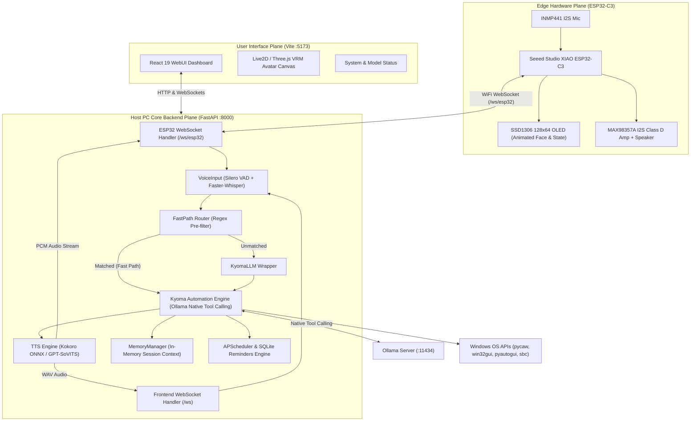
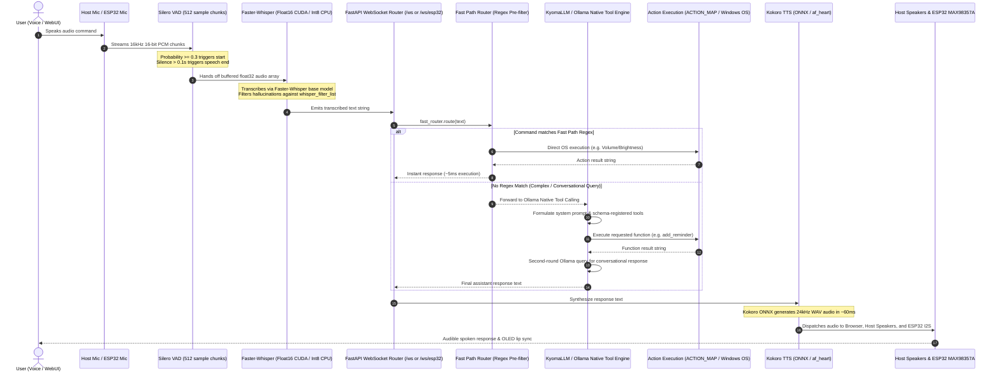
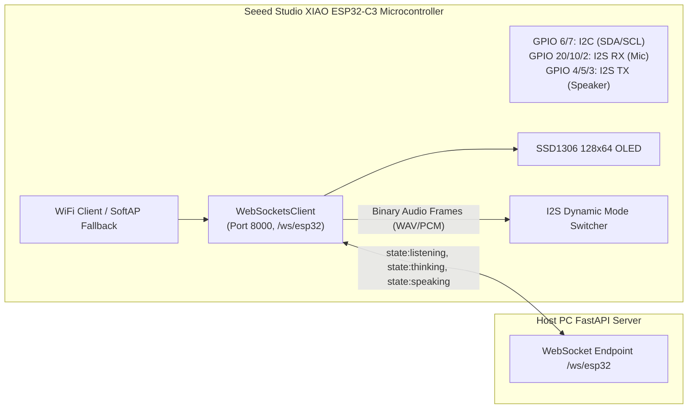

# Kyoma — Consolidated Architecture & Technical Reference

> Merged from Phase 0 architecture, codebase map, voice/AI pipeline, storage, and reuse documentation.

## Table of Contents
1. [Project Overview](#kyoma-project-overview)
2. [Codebase Map](#kyoma-codebase-map)
3. [Voice & AI Pipeline](#kyoma-voice-and-ai-pipeline)
4. [Features & Integrations](#kyoma-features-and-integrations)
5. [Storage & Data Flow](#kyoma-storage-and-data-flow)
6. [Reuse Blueprint](#kyoma-reuse-blueprint)
7. [Base Instructions](#kyoma-base-instructions)
8. [Verification & Open Questions](#kyoma-verification-and-open-questions)

> **Related Docs:** [KYOMA_REPORTS.md](KYOMA_REPORTS.md) | [AgentsMD.md](AgentsMD.md) | [KyomaMD.md](KyomaMD.md) | [ProgressMD.md](ProgressMD.md)


---

<!-- Source: KYOMA_PROJECT_OVERVIEW.md -->

# Document 1: KYOMA Project Overview & Architecture Blueprint

## 1. Executive Summary & Project Purpose

**KYOMA** is an offline, multi-modal desktop assistant and PC automation system. Originating from an open-source AI VTuber foundation (**LocalAIVtuber2 / LAV 2.0**), the codebase has been extensively adapted into **KYOMA: Offline AI-Enabled Desktop Companion & PC Automation System**. 

The application fulfills two interrelated roles:
1. **Physical Edge Companion & Interactive Virtual Avatar**: Interfaces with a physical hardware companion powered by a **Seeed Studio XIAO ESP32-C3** microcontroller (with an SSD1306 OLED display for animated facial expressions and hardware state rendering) alongside a browser-based 2D/3D VTuber avatar (Live2D / Three.js VRM).
2. **Deterministic & Agentic Windows PC Automation**: Translates natural voice commands and WebUI text queries into native Windows OS API actions—such as system volume/mute, monitor brightness, window management, screen capture with clipboard integration and Windows notifications, media playback keys, web searches, application execution, and persistent SQLite-backed desktop reminders.

---

## 2. Technical Baseline & Environment Identity

- **Project Root Path**: `c:\Users\harsh\Downloads\LocalAIVtuber2-master\LocalAIVtuber2-master`
- **Host Operating System**: Windows 10 / 11 (64-bit)
- **Primary Programming Language**: Python 3.10+ (Current runtime tested with Python 3.13 in `c:\Users\harsh\Downloads\LocalAIVtuber2-master\venv`)
- **Frontend Stack**: TypeScript 5.7, React 19, Vite 6.2, TailwindCSS v4, Radix UI, PixiJS (Live2D), Three.js (`@pixiv/three-vrm`)
- **Backend Stack**: FastAPI (Uvicorn ASGI), WebSockets, asyncio, Pydantic, Requests
- **Audio & AI Stack**: Silero VAD, Faster-Whisper (CTranslate2), Ollama (Mistral-7B / Gemma4), Kokoro TTS (ONNX Runtime) / GPT-SoVITS, Qdrant (FastEmbed / all-MiniLM-L6-v2)
- **Firmware Stack**: C++ (PlatformIO / Arduino framework for Espressif ESP32-C3)
- **Entry Points & Launchers**:
  - `start.bat`: Orchestrates Vite frontend dev server (`localhost:5173`) and FastAPI backend (`localhost:8000`).
  - `backend/server.py`: FastAPI server handling WebSockets, REST APIs, and pipeline orchestration.
  - `Kyoma/Kyoma_automation.py`: Standalone CLI REPL loop for automation testing.
  - `esp32_firmware/src/main.cpp`: Microcontroller firmware connecting over WebSocket.

---

## 3. High-Level Architecture Overview

The system is organized into three major architectural planes:



---

## 4. Current Implementation Status vs. Documentation Discrepancies

A critical objective of this audit was verifying actual code implementation against existing marketing/README documentation:

| Claimed Feature | Documented Status | Verified Codebase Status | Evidence / Source Code Reference |
|---|---|---|---|
| **ESP32 Audio Input** | Active edge microphone streaming | ⚠️ **Disabled / Commented Out** in server | `backend/server.py:256-259` (`# raw = message.get("bytes") ... voice_input.process_esp32_audio(raw, clients)`) |
| **Microphone Input Source** | ESP32 INMP441 I2S Mic | Active: **Host PC / Laptop Microphone** | `backend/services/Input/Input.py:101` (`sd.InputStream` on host) |
| **ESP32 Audio Output** | Speaker playback of assistant voice | ✅ **Implemented & Active** | `backend/server.py:346-353`, `backend/server.py:989-1003` |
| **ESP32 Expression Display** | Animated eyes, mouth sync, status rings | ✅ **Implemented & Working** | `esp32_firmware/src/main.cpp:302-372` |
| **Ollama Tool Calling** | Native tool calling | ✅ **Implemented & Working** | `Kyoma/Kyoma_automation.py:557-662` |
| **Fast Path Router** | Sub-millisecond direct execution | ✅ **Implemented & Working** | `Kyoma/fast_router.py:1-691`, `backend/services/LLM/KyomaLLM.py:69-74` |
| **RAG Vector Memory** | Claimed: FAISS + sentence-transformers | ❌ **Discrepancy: Qdrant used, FAISS unused** | `backend/services/Memory/Memory.py:5-30` uses `QdrantClient`. Kyoma automation uses `MemoryManager` (simple list) |
| **Active TTS Engine** | Claimed: EdgeTTS / GPT-SoVITS | Active: **Kokoro ONNX** (`af_heart`) | `backend/settings.json:10,16` (`tts.provider: kokoro`) |
| **Reminders System** | Background scheduled notifications | ✅ **Implemented & Working** (SQLite + win10toast) | `Kyoma/reminder_utils.py:51-68, 130-180` |
| **Screen Vision Context** | Real-time screen OCR / Vision | ⚠️ **Partially Implemented** (LAV legacy; not tied to Kyoma pipeline) | `backend/services/Input/VisionInput.py` exists, but Kyoma uses `screenshot.py` |


---

<!-- Source: KYOMA_CODEBASE_MAP.md -->

# Document 2: KYOMA Codebase Map & Module Inventory

## 1. Directory Tree Hierarchy

The project root is located at `c:\Users\harsh\Downloads\LocalAIVtuber2-master\LocalAIVtuber2-master`. Below is the complete structural map:

```text
LocalAIVtuber2-master/
├── start.bat                             # Windows launcher script (Vite + FastAPI)
├── readme.md                             # High-level project README
├── backend/                              # Python backend application root
│   ├── server.py                         # Main FastAPI ASGI application & WebSocket hub
│   ├── auth.py                           # API key generator & validator (auth token storage)
│   ├── settings.json                     # Active runtime settings (model, voice, UI options)
│   ├── settings.json.example             # Fallback template settings
│   ├── requirements.txt                  # Full pinned pip dependencies
│   ├── requirements_loose.txt            # Loose core dependencies
│   ├── download_kokoro_weights.py        # Helper to fetch Kokoro ONNX model & voice bins
│   ├── download_tts_weights.py           # Helper to fetch GPT-SoVITS base weights
│   ├── data/                             # Generated backend data (api_key.txt)
│   └── services/                         # Core service subsystems
│       ├── Input/                        # Speech & Vision ingestion
│       │   ├── Input.py                  # Host VoiceInput (Silero VAD + Faster-Whisper STT)
│       │   ├── VisionInput.py            # Screen capture + EasyOCR worker
│       │   └── voice_recording.wav       # Temporary audio recording buffer
│       ├── LLM/                          # Large Language Model abstraction layer
│       │   ├── LLM.py                    # Multi-provider model loader & catalog
│       │   ├── BaseLLM.py                # Abstract base class for streaming chat completions
│       │   ├── KyomaLLM.py               # Kyoma Automation bridge (lazy-loader & fast-router)
│       │   ├── OllamaLLM.py              # Ollama direct chat streaming wrapper
│       │   ├── TextLLM.py                # Local llama-cpp-python GGUF text wrapper
│       │   ├── VisionLLM.py              # Local llama-cpp-python vision (mmproj) wrapper
│       │   └── Models/                   # Model metadata and weights directory
│       ├── TTS/                          # Text-to-Speech synthesis subsystem
│       │   ├── TTS.py                    # TTS facade & active provider switch
│       │   ├── Kokoro/                   # Kokoro ONNX offline TTS
│       │   │   ├── KokoroTTS.py          # Kokoro ONNX synthesis wrapper
│       │   │   └── models/               # kokoro-v1.0.onnx & voices-v1.0.bin
│       │   └── GPTsovits/                # GPT-SoVITS neural voice cloning system
│       ├── Memory/                       # Long-term semantic & session memory (LAV 2.0)
│       │   ├── Memory.py                 # Qdrant vector database wrapper
│       │   ├── HistoryStore.py           # JSON session file persistence
│       │   ├── ChatChunker.py            # Sliding window message chunker
│       │   ├── chat_sessions/            # Session JSON storage
│       │   └── data/                     # Local Qdrant embedded database directory
│       ├── Character/                    # VTuber model management
│       │   ├── characterManager.py       # Live2D & VRM model discovery and file serving
│       │   ├── live2D/                   # Live2D cubism assets
│       │   └── VRM3D/                    # Three.js VRM avatars
│       ├── ChatFetch/                    # YouTube live stream chat fetcher
│       │   └── Chatfetch.py              # pytchat integration
│       └── lib/                          # Backend utilities
│           ├── LAV_logger.py             # Formatted color console logger
│           ├── ollama_utils.py           # Ollama server liveness check & health
│           ├── process_manager.py        # Subprocess lifecycle management (e.g., RVC)
│           ├── port_forward.py           # Reverse proxy middleware
│           └── startup_progress.py       # Server boot milestone tracker
├── Kyoma/                                # Dedicated Windows PC Automation Engine
│   ├── Kyoma_automation.py               # Core automation engine, Ollama tool caller, CLI REPL
│   ├── fast_router.py                    # Zero-LLM regex command pre-router (high speed)
│   ├── kyoma_config.json                 # Persistent active Ollama model config
│   ├── memory_manager.py                 # Lightweight sliding-window in-memory message history
│   ├── app_utils.py                      # App launch (.lnk/exe), maximize, minimize, close
│   ├── volume_control.py                 # Windows core audio endpoint volume (pycaw)
│   ├── display_control.py                # Monitor brightness (WMI/sbc) and lock workstation
│   ├── media_control.py                  # Windows virtual key media controls (play/pause/skip)
│   ├── system_info_utils.py              # psutil, socket, and WMI hardware diagnostics
│   ├── screenshot.py                     # Fullscreen capture, thumbnailing, clipboard, toast
│   ├── reminder_utils.py                 # APScheduler + SQLite desktop reminder engine
│   ├── window_manager.py                 # Multi-monitor window tiling, focus mode, monitor swap
│   ├── Reminders logs/                   # Reminders SQLite database & execution log
│   │   ├── reminders.db                  # SQLite database for scheduled tasks & birthdays
│   │   └── reminder.log                  # Plaintext execution log
│   └── Kyoma Screenshots/                # Captured screenshots and thumbnails
│       ├── thumbs/                       # Thumbnail cache (purged on startup)
│       ├── screenshot_log.txt            # Audit trail of captured screens
│       └── YYYY-MM-DD/                   # Daily organized screenshot image files
├── frontend/                             # Vite + React WebUI
│   ├── package.json                      # Node packages & scripts
│   ├── vite.config.ts                    # Vite configuration & proxying
│   ├── src/
│   │   ├── App.tsx                       # Main React root & view routing
│   │   ├── pages/                        # View pages (llmPage, ttsPage, mainpage, etc.)
│   │   ├── components/                   # UI components (voice-streamer, loading-screen, etc.)
│   │   ├── context/                      # SettingsContext (state synchronization)
│   │   └── lib/                          # API client, sessionManager, ttsManager, pipelineManager
├── esp32_firmware/                       # PlatformIO C++ firmware for XIAO ESP32-C3
│   ├── platformio.ini                    # Hardware build settings & libraries
│   └── src/
│       └── main.cpp                      # OLED animations, I2S mic/speaker, WebSocket client
└── assets/                               # Architectural diagrams, CAD renders, wiring schematics
```

---

## 2. Comprehensive Module Inventory Table

| Relative Path | Primary Purpose | Key Classes / Functions | Imported / Used By | Writes / Modifies | Status | Reuse Potential for Receptionist |
|---|---|---|---|---|---|---|
| `backend/server.py` | FastAPI ASGI web server & WebSocket hub | `websocket_endpoint`, `websocket_esp32`, `run_esp32_pipeline`, `APIKeyMiddleware` | `start.bat`, WebUI, ESP32 | Memory, Settings, Audio temp | **Active** | **Adaptable**: Excellent template for receptionist HTTP/WS server, but needs VTuber logic pruned. |
| `backend/auth.py` | Generates & validates persistent API key | `get_or_create_api_key`, `API_KEY` | `backend/server.py` | `backend/data/api_key.txt` | **Active** | **Reusable As-Is**: Clean, secure, token-based local security. |
| `backend/settings.json` | Stores runtime system preferences | Configuration dictionary | `server.py`, `TTS.py`, WebUI | `backend/server.py` | **Active** | **Adaptable**: Adapt settings schema for receptionist configuration. |
| `backend/services/Input/Input.py` | Host audio capture, Silero VAD, Faster-Whisper STT | `VoiceInput`, `start_streaming`, `process_speech`, `mute`, `unmute` | `backend/server.py` | `voice_recording.wav` | **Active** | **Reusable As-Is**: Production-grade local STT pipeline with sub-300ms VAD. |
| `backend/services/Input/VisionInput.py` | Screen capture + EasyOCR OCR worker | `VisionInput`, `capture_and_ocr` | `backend/server.py` | Temp screenshots | **Experimental** | **Not Reusable**: Unneeded for voice receptionist unless kiosk screen analysis is required. |
| `backend/services/LLM/LLM.py` | Model catalog & loading facade | `LLM`, `load_model`, `_load_available_models` | `backend/server.py` | Model metadata cache | **Active** | **Adaptable**: Useful if dynamic model switching (GGUF vs Ollama) is desired. |
| `backend/services/LLM/KyomaLLM.py` | Kyoma automation LLM bridge | `KyomaLLM`, `get_chat_completion` | `backend/services/LLM/LLM.py` | None | **Active** | **Adaptable**: Replace Kyoma automation tools with receptionist dialogue/tools. |
| `backend/services/LLM/OllamaLLM.py` | Direct streaming Ollama chat | `OllamaLLM`, `get_chat_completion` | `backend/services/LLM/LLM.py` | None | **Active** | **Reusable As-Is**: Clean Ollama streaming wrapper. |
| `backend/services/TTS/TTS.py` | Multi-engine TTS facade | `TTS`, `set_provider`, `synthesize`, `change_voice` | `backend/server.py` | None | **Active** | **Reusable As-Is**: Great facade for switching local speech engines. |
| `backend/services/TTS/Kokoro/KokoroTTS.py` | Offline ONNX Kokoro TTS synthesis | `KokoroTTS`, `synthesize`, `get_available_voices` | `backend/services/TTS/TTS.py` | Memory WAV buffers | **Active** | **Reusable As-Is**: Extremely fast, natural-sounding, CPU/GPU offline voice engine. |
| `backend/services/TTS/GPTsovits/GptSovits.py` | Neural voice cloning TTS | `GptSovits`, `synthesize` | `backend/services/TTS/TTS.py` | Temp WAV | **Active (Alternative)** | **Adaptable**: Useful only if customized voice cloning of a specific person is required. |
| `backend/services/Memory/Memory.py` | Semantic RAG memory (Qdrant + FastEmbed) | `Memory`, `insert_history`, `query` | `backend/server.py` | `backend/services/Memory/data/` | **Active in LAV (Unused in Kyoma)** | **Adaptable**: Ideal for Receptionist FAQ retrieval and company knowledge base! |
| `backend/services/Memory/HistoryStore.py` | Multi-session JSON chat history | `HistoryStore`, `create_session`, `update_session` | `backend/server.py` | `chat_sessions/*.json` | **Active in LAV** | **Adaptable**: Excellent for storing guest/visitor interaction transcripts. |
| `Kyoma/Kyoma_automation.py` | Intent parsing, Ollama tool calling, execution | `query_ollama_with_tools`, `execute_action`, `ACTION_MAP` | `KyomaLLM.py`, Standalone REPL | OS state, Reminders | **Active** | **Adaptable**: Tool routing architecture is ideal; replace desktop tools with receptionist actions (calendar, booking, transfer). |
| `Kyoma/fast_router.py` | Regex pre-filter for instant execution | `route`, compiled regex patterns | `KyomaLLM.py` | Direct OS tools | **Active** | **Reusable With Adaptation**: Tremendous latency benefit; adapt patterns to receptionist greetings and quick queries. |
| `Kyoma/memory_manager.py` | In-memory sliding window history | `MemoryManager`, `add_user_message`, `get_messages` | `Kyoma_automation.py` | In-memory list | **Active** | **Reusable As-Is**: Simple, robust session context buffer. |
| `Kyoma/reminder_utils.py` | Background task scheduler & notifications | `add_reminder`, `start_scheduler`, `init_db` | `Kyoma_automation.py` | `Reminders logs/reminders.db`, `reminder.log` | **Active** | **Reusable With Adaptation**: Clean APScheduler + SQLite setup; can power appointment reminders or staff notifications. |
| `Kyoma/screenshot.py` | Screen capture, thumbnails, clipboard | `take_screenshot_save`, `clean_old_thumbs` | `Kyoma_automation.py` | `Kyoma Screenshots/*` | **Active** | **Kyoma-Specific**: Not relevant for a voice receptionist. |
| `Kyoma/volume_control.py` | Windows pycaw audio endpoint control | `set_volume`, `mute_volume`, `get_volume` | `Kyoma_automation.py`, `fast_router.py` | Windows Audio Endpoint | **Active** | **Kyoma-Specific**: Only useful if receptionist runs on a dedicated kiosk controlling speaker level. |
| `Kyoma/display_control.py` | WMI brightness and workstation lock | `set_brightness`, `lock_screen` | `Kyoma_automation.py`, `fast_router.py` | Windows WMI / User32 | **Active** | **Kyoma-Specific**: Not typically required for receptionist logic. |
| `Kyoma/media_control.py` | Windows virtual media keys | `play_pause`, `next_track` | `Kyoma_automation.py`, `fast_router.py` | Windows User32 keybd_event | **Active** | **Kyoma-Specific**: Desktop personal companion feature. |
| `Kyoma/app_utils.py` | Process launcher (.lnk/exe) and window control | `open_application`, `close_application` | `Kyoma_automation.py`, `fast_router.py` | Windows OS processes | **Active** | **Kyoma-Specific**: Desktop automation feature. |
| `Kyoma/window_manager.py` | Multi-monitor window tiling and focus mode | `tile_windows`, `focus_only_active` | Direct import (Optional) | Windows Win32gui | **Active (Utility)** | **Kyoma-Specific**: Desktop automation feature. |
| `Kyoma/system_info_utils.py` | Hardware telemetry (CPU, battery, WiFi) | `get_battery`, `get_network_status`, `get_time` | `Kyoma_automation.py`, `fast_router.py` | None | **Active** | **Adaptable**: System health, battery, and time functions are useful for an edge receptionist kiosk. |
| `esp32_firmware/src/main.cpp` | ESP32-C3 firmware (OLED, I2S, WiFi, WS) | `webSocketEvent`, `updateDisplay`, `initI2SMic`, `initI2SSpeaker` | Compiled to ESP32 ROM | Hardware pins, OLED, I2S | **Active** | **Adaptable**: Perfect physical desk robot/kiosk hardware unit for greeting guests! |
| `frontend/` (React App) | VTuber WebUI dashboard | React App, Live2D/VRM, Chat UI | Browser | Browser local storage | **Active in LAV** | **Adaptable**: Avatar rendering and settings panels can be replaced with a professional Receptionist UI. |


---

<!-- Source: KYOMA_VOICE_AND_AI_PIPELINE.md -->

# Document 3: KYOMA Voice & AI Pipeline Analysis

## 1. End-to-End Voice & Intelligence Pipeline Architecture

The pipeline spans physical audio ingestion, voice activity detection, automatic speech recognition, semantic routing, natural language reasoning with tool calling, speech synthesis, and audio dispatch.



---

## 2. Speech-to-Text (STT) Subsystem

Implemented in `backend/services/Input/Input.py`.

- **Library & Model**: `faster-whisper` (version 1.1.1) utilizing CTranslate2.
- **Model Variant**: `WhisperModel("base", device="cuda" if torch.cuda.is_available() else "cpu", compute_type="float16" if cuda else "int8")` (`backend/services/Input/Input.py:44`).
- **Voice Activity Detection**: `silero_vad` (`load_silero_vad`, `VADIterator`).
  - Sampling rate: 16,000 Hz, single channel (mono), 16-bit signed integer.
  - VAD chunk size: 512 samples (~32 ms).
  - Speech threshold: `SPEECH_THRESHOLD = 0.3` (`backend/services/Input/Input.py:24`).
  - Silence timeout: `SILENCE_WAIT_TIME = 0.1 * SAMPLING_RATE` (100 ms).
  - Pre-speech padding: `0.5 * SAMPLING_RATE` (500 ms).
  - Post-speech padding: `0.5 * SAMPLING_RATE` (500 ms).
- **Hallucination Prevention**:
  - `whisper_filter_list`: Drops repetitive Whisper artifacts such as `"thanks for watching"`, `"thank you"`, `"there is no message"`, etc. (`backend/services/Input/Input.py:19-23`).
  - Regex stripping cleans punctuation; if nothing remains, the transcription is discarded (`backend/services/Input/Input.py:217-221`).
- **Hardware Integration & Routing**:
  - **Host Microphone**: Active via `sounddevice.InputStream` (`backend/services/Input/Input.py:101`).
  - **ESP32 Edge Microphone**: Dedicated method `process_esp32_audio(audio_bytes, clients)` exists (`backend/services/Input/Input.py:120-132`), but incoming binary processing from ESP32 is commented out in `backend/server.py:256-259` to prioritize the laptop microphone.
- **Audio Persistence**: Saves temporary audio to `backend/services/Input/voice_recording.wav` before passing to Whisper (`backend/services/Input/Input.py:203-208`).

---

## 3. Large Language Model (LLM) Subsystem

### 3.1 Architecture & Models
- **Primary Engine**: **Ollama** running locally on `http://localhost:11434`.
- **Configured Model**: Read from `Kyoma/kyoma_config.json`. Currently configured to: `gemma4:e2b` (fallback: `mistral`) (`Kyoma/Kyoma_automation.py:84-93`).
- **Server Bridge**: `backend/services/LLM/KyomaLLM.py` provides lazy background loading of `Kyoma_automation` to keep FastAPI startup non-blocking (`backend/services/LLM/KyomaLLM.py:20-34`).

### 3.2 Two-Tier Routing Mechanism
1. **Tier 1: Fast Path Router (`Kyoma/fast_router.py`)**:
   - Employs 20+ pre-compiled regex categories intercepting simple intent phrases (e.g. volume up/down/mute, brightness, application launching, media play/pause/skip, battery status, time/date).
   - Execution time: **< 10ms**, bypassing the LLM completely and eliminating 1.5s–5s of inference delay.
2. **Tier 2: Ollama Native Tool Calling (`Kyoma/Kyoma_automation.py:546-674`)**:
   - Registered tools: 37 functions passed directly to `ollama.chat(model=OLLAMA_MODEL, tools=AVAILABLE_TOOLS)`.
   - Tool execution loop: Parses `tool_calls` in message response, invokes target Python functions, feeds results back into `memory.add_tool_message()`, and requests a brief final conversational completion (`num_predict: 80, temperature: 0.3`).
   - Graceful fallback: If the configured Ollama model does not support native tool calling, catches the exception and falls back to text generation (`Kyoma/Kyoma_automation.py:567-577`).

### 3.3 Prompt & Generation Parameters
- **System Prompt**:
  > *"You are Kyoma, a PC automation assistant. Always call a tool for PC tasks — never say you can't. Reply short and direct. Use only 3-10 words to respond."* (`Kyoma/Kyoma_automation.py:550-554`)
- **Second-Round Chat Options**:
  - `num_ctx`: 1024 tokens
  - `num_predict`: 80 tokens
  - `temperature`: 0.3
  - `keep_alive`: "1h"

---

## 4. Text-to-Speech (TTS) Subsystem

Managed via `backend/services/TTS/TTS.py` with the active engine specified in `backend/settings.json`.

### 4.1 Active Provider: Kokoro TTS (`backend/services/TTS/Kokoro/KokoroTTS.py`)
- **Runtime**: ONNX Runtime via `kokoro-onnx`.
- **Model Files**:
  - `backend/services/TTS/Kokoro/models/kokoro-v1.0.onnx`
  - `backend/services/TTS/Kokoro/models/voices-v1.0.bin`
- **Active Voice**: `af_heart` (American Female - Warm & Expressive).
- **Audio Output**: 24,000 Hz, 16-bit PCM WAV.
- **Latency**: Sub-100ms synthesis on modern CPUs/GPUs.
- **Operation**: 100% offline; zero cloud network calls.

### 4.2 Alternative Provider: GPT-SoVITS (`backend/services/TTS/GPTsovits/GptSovits.py`)
- Used when deep voice cloning from reference audio is required.
- Model weights stored in `backend/services/TTS/GPTsovits/models/`.

### 4.3 Multi-Channel Audio Dispatch
When speech is synthesized:
1. Streamed as WAV HTTP response to the browser WebUI (`backend/server.py:978-980`).
2. Transmitted as raw binary frames over WebSocket `/ws/esp32` to the ESP32 microcontroller (`backend/server.py:346-353, 989-1003`).
3. Microcontroller decodes 16-bit samples and drives the **MAX98357A I2S Class D Amplifier** powering the physical desktop speaker (`esp32_firmware/src/main.cpp:759-766`).

---

## 5. Wake-Word, Push-to-Talk, & Conversation Dynamics

| Capability | Implementation Status | Evidence / Analysis |
|---|---|---|
| **Continuous Listening** | ✅ **Implemented & Working** | VAD-driven stream constantly monitors audio chunks (`backend/services/Input/Input.py:83-106`). |
| **Wake-Word Detection** | ❌ **Missing / Not Implemented** | No Porcupine, Snowboy, or custom wake-word engine exists. The system relies entirely on VAD thresholding. |
| **Push-to-Talk** | ⚠️ **Partially Implemented** | WebUI provides a toggle switch; ESP32 firmware loop supports stream gating, but no dedicated physical push button is wired in firmware logic. |
| **Barge-In / Interruption** | ✅ **Implemented & Working** | `VoiceInput.mute()` immediately purges buffers and resets VAD states during playback (`backend/services/Input/Input.py:61-70`). |
| **Bimodal Audio Out** | ✅ **Implemented & Working** | Dual playback over host audio output and ESP32 hardware speaker simultaneously. |


---

<!-- Source: KYOMA_FEATURES_AND_INTEGRATIONS.md -->

# Document 5: KYOMA Features, Automation & Hardware Integrations

## 1. Windows Automation Capabilities & `ACTION_MAP`

The heart of Kyoma's PC automation is implemented across modular scripts in `Kyoma/` and aggregated in `Kyoma/Kyoma_automation.py:168-224`.

Every capability maps directly to Windows system APIs, WMI interfaces, COM endpoints, or sub-processes.

| Action / Intent Name | Underlying Windows API / Mechanism | Target File & Line Reference | Validation & Error Handling |
|---|---|---|---|
| `set_volume` | Windows Core Audio COM Endpoint (`pycaw.AudioUtilities`) | `Kyoma/volume_control.py:12-25` | Level clamped to integer range `0 - 100%`. |
| `change_volume` (`up`/`down`) | Endpoint scalar increment/decrement by `0.05` (5%) | `Kyoma/volume_control.py:28-42` | Clamped to `0.0 - 1.0`. |
| `mute` / `unmute` | `EndpointVolume.SetMute(1 or 0, None)` | `Kyoma/volume_control.py:44-55` | Validated through COM interface. |
| `get_volume` | `EndpointVolume.GetMasterVolumeLevelScalar()` | `Kyoma/volume_control.py:58-62` | Returns integer 0-100. |
| `set_brightness` | Windows WMI via `screen-brightness-control` | `Kyoma/display_control.py:19-28` | Clamped to integer `0 - 100%`. |
| `brightness_up` / `down` | Delta adjustment (+10% / -10%) across active monitors | `Kyoma/display_control.py:43-72` | Safe monitor averaging if multi-display. |
| `lock_screen` | `ctypes.windll.user32.LockWorkStation()` | `Kyoma/display_control.py:78-85` | Direct Windows API lock call. |
| `media_play_pause`, `next`, `prev` | `ctypes.windll.user32.keybd_event(0xB0/0xB1/0xB3)` | `Kyoma/media_control.py:11-43` | Sends hardware keyup/keydown with 50ms sleep. |
| `open_application` | Windows Shell `.lnk` resolver + `subprocess.Popen` | `Kyoma/app_utils.py:167-248` | Heuristic search across `APP_SHORTCUTS`, `SYSTEM_APPS`, and PATH. |
| `close_application` | `psutil.process_iter()` matching name + `.kill()` | `Kyoma/app_utils.py:143-164` | Iterates process tree, filters matching processes. |
| `take_screenshot_save` | `pyautogui.screenshot()` + PIL thumbnail + `winotify` | `Kyoma/screenshot.py:70-155` | Saves full PNG, creates thumbnail, copies BMP bytes to clipboard (`win32clipboard`), triggers interactive Windows notification with "View", "Edit", and "Open Folder" action buttons. |
| `add_reminder` | `dateparser.parse()` + `sqlite3` + `APScheduler` | `Kyoma/reminder_utils.py:130-180` | Normalizes natural language time string to future datetime; inserts into SQLite; registers in background scheduler. |
| `list_reminders` / `cancel` | SQLite query & job cancellation | `Kyoma/reminder_utils.py:182-270` | Queries pending reminders or marks cancelled. |
| `tile_windows` | `win32gui`, `win32api.EnumDisplayMonitors` | `Kyoma/window_manager.py:10-42` | Computes monitor dimensions and resizes all visible windows side-by-side. |
| `focus_only_active` | `pygetwindow.getActiveWindow()` + `w.close()` | `Kyoma/window_manager.py:43-66` | Closes all background windows except focused. |
| `system_info` diagnostics | `psutil.sensors_battery`, `cpu_percent`, `virtual_memory`, `wmi` | `Kyoma/system_info_utils.py:14-99` | Power status, battery %, WiFi/Ethernet connectivity test (pinging 8.8.8.8:53), VPN presence check, disk usage. |

---

## 2. Desktop Reminders & Scheduling Architecture

Implemented in `Kyoma/reminder_utils.py`.

- **Scheduler Engine**: `apscheduler.schedulers.background.BackgroundScheduler`.
- **Startup Sync**: On startup (`start_scheduler()`), the scheduler queries `reminders.db` for all records with `status = 'pending'`, compares their `time` against `datetime.now()`, and either schedules the job or marks missed tasks as overdue.
- **Notification Trigger**:
  - When a job triggers, the callback executes `toaster.show_toast(title, message, duration=10, icon_path=...)` using `win10toast_click`.
  - Also sets Windows AppUserModelID: `ctypes.windll.shell32.SetCurrentProcessExplicitAppUserModelID(u'Kyoma.Assistant')` so desktop notifications display the custom application brand rather than "Python".
  - Thread-safe append log written to `Reminders logs/reminder.log`.

---

## 3. Physical Hardware Integration (ESP32-C3)

The hardware client is documented in `esp32_firmware/src/main.cpp`.



### 3.1 Hardware Pin Mapping Table
- **OLED Display (SSD1306 I2C)**: `SDA = GPIO 6`, `SCL = GPIO 7`
- **Microphone (INMP441 I2S Input)**: `SCK = GPIO 20`, `WS = GPIO 10`, `SD = GPIO 2`
- **Speaker Amp (MAX98357A I2S Output)**: `BCLK = GPIO 4`, `LRC = GPIO 5`, `DIN = GPIO 3`

### 3.2 Dynamic I2S Pin Multiplexing
Because the ESP32-C3 features only **one hardware I2S peripheral (`I2S_NUM_0`)**, it cannot run RX (microphone capture) and TX (speaker synthesis) simultaneously. The firmware cleanly solves this through dynamic hardware switching:
- `initI2SMic()`: Installs 32-bit RX driver (`esp32_firmware/src/main.cpp:75-104`).
- `initI2SSpeaker()`: Uninstalls RX driver, clears DMA buffers, and installs 16-bit TX driver (`esp32_firmware/src/main.cpp:106-136`).
- `uninstallI2S()`: Completely uninstalls driver to eliminate idle speaker hum during thinking states (`main.cpp:67-73`).

### 3.3 Animated Facial Expressions & States
The OLED display renders a high-frame-rate procedural eye-and-mouth face with realistic cubic easing (`easeInOut`):
- `STATE_BOOT`: Multi-phase futuristic startup sweep, circle expansion, and audio synth stabs (`main.cpp:504-567`).
- `STATE_IDLE`: Natural eye blinking, random pupil saccades, slight smiling mouth (`main.cpp:670-699`).
- `STATE_LISTENING`: Glowing pulsating audio ring centered around mouth (`main.cpp:368-372, 700-703`).
- `STATE_THINKING`: Narrowed focused eyes and orbital rotating halo dots (`main.cpp:360-366, 704-711`).
- `STATE_SPEAKING`: Real-time sinusoidal mouth opening modulating synchronously with speech playback (`main.cpp:713-722`).
- **Network Glitch Effect**: If WiFi or WebSocket disconnects, the display programmatically applies visual static and CRT scanline glitches (`main.cpp:384-448`).

### 3.4 SoftAP Captive Portal Configuration
If WiFi cannot connect within 15 seconds, the ESP32 starts a local Access Point (`KYOMA_VOICE_CONFIG`) serving an embedded web portal (`192.168.4.1`) where users can input WiFi credentials, Server IP, and API key, saving directly to flash NVS (`main.cpp:783-821`).


---

<!-- Source: KYOMA_STORAGE_AND_DATA_FLOW.md -->

# Document 4: KYOMA Storage & Data Flow Inventory

## 1. Comprehensive Storage Inventory Table

| Data Category | Actual Location on Disk | Path Resolution Mechanism | Format / Engine | Created By | Read By | Lifetime / Retention | Sensitive Content |
|---|---|---|---|---|---|---|---|
| **API Authentication Key** | `backend/data/api_key.txt` | `Path(__file__).parent / "data"` | Plaintext URL-safe token (32 bytes) | `backend/auth.py:11` | `backend/auth.py:8`, `server.py` | Persistent across reboots | ⚠️ **Secret**: Bearer token granting full control |
| **System Settings** | `backend/settings.json` | Project-relative via `__file__` | JSON document | Manual / WebUI API | `backend/server.py`, `TTS.py` | Persistent | Contains preferred model names, voices, and UI positions |
| **Kyoma Model Config** | `Kyoma/kyoma_config.json` | Project-relative via `__file__` | JSON (`{"ollama_model": ...}`) | `Kyoma_automation.py:717`, `server.py:934` | `Kyoma_automation.py:87`, `server.py:909` | Persistent | None (model identifier string) |
| **Reminders Database** | `Kyoma/Reminders logs/reminders.db` | `Path(__file__).parent / "Reminders logs"` | **SQLite 3** (`reminders` table) | `Kyoma/reminder_utils.py:56-64` | `reminder_utils.py:180-230` | Persistent | User reminder notes and schedules |
| **Reminders Audit Log** | `Kyoma/Reminders logs/reminder.log` | Project-relative via `Path` | Timestamped append-only text | `reminder_utils.py:46` | Diagnostic analysis | Persistent | History of triggered and deleted reminders |
| **Screenshots & Thumbs** | `Kyoma/Kyoma Screenshots/YYYY-MM-DD/` and `thumbs/` | Date-organized folder path | PNG images & resized JPEG/PNG thumbnails | `Kyoma/screenshot.py:104, 114` | Windows notifications, WebUI | Images persistent; `thumbs/` deleted on launch (`screenshot.py:13`) | ⚠️ **High**: Captures entire user desktop screen |
| **Screenshot Audit Log** | `Kyoma/Kyoma Screenshots/screenshot_log.txt` | Project-relative via `Path` | Fixed-width formatted text | `Kyoma/screenshot.py:60-66` | User review | Persistent | Window titles, timestamps, file paths |
| **Temporary Audio Recording** | `backend/services/Input/voice_recording.wav` | Directory of `Input.py` | 16kHz 16-bit mono WAV | `Input.py:203` | `faster-whisper` transcribe | Ephemeral (overwritten on each utterance) | Spoken microphone audio snippet |
| **Chat Session Transcripts** | `backend/services/Memory/chat_sessions/{uuid}.json` | Project-relative via `__file__` | Formatted JSON array | `HistoryStore.py:48` | `HistoryStore.py:69`, WebUI | Persistent per session | User dialogue transcripts |
| **Semantic Vector Database** | `backend/services/Memory/data/` | Project-relative via `__file__` | Embedded **Qdrant** database | `Memory.py:24` (`QdrantClient(path=...)`) | `Memory.py:137` | Persistent | Embedded vectors of past user chats |
| **Kokoro ONNX Models** | `backend/services/TTS/Kokoro/models/` | Project-relative via `__file__` | Binary ONNX (`kokoro-v1.0.onnx`, `voices-v1.0.bin`) | `download_kokoro_weights.py` | `KokoroTTS.py:82` | Static pre-downloaded | Large model binary assets |
| **GPT-SoVITS Weights** | `backend/services/TTS/GPTsovits/models/` | Project-relative via `__file__` | PyTorch checkpoints (`.pth`, `.ckpt`) | `download_tts_weights.py` | `GptSovits.py` | Static pre-downloaded | Pretrained neural voice weights |
| **ESP32 Firmware Flash** | Microcontroller Non-Volatile Storage (NVS) | ESP32 Preferences API (`preferences.begin("kyoma")`) | Key-Value NVS flash | `esp32_firmware/src/main.cpp:806-811` | `main.cpp:773-778` | Persistent on microcontroller hardware | ⚠️ Contains WiFi SSID & Password |

---

## 2. Database Schema Details: `reminders.db`

The SQLite database initialized in `Kyoma/reminder_utils.py:51-68` contains the `reminders` table:

```sql
CREATE TABLE reminders (
    id INTEGER PRIMARY KEY AUTOINCREMENT,
    title TEXT NOT NULL,
    message TEXT,
    time TEXT NOT NULL,
    status TEXT DEFAULT 'pending',
    repeat_interval TEXT DEFAULT NULL
);
```

### Column Specifications:
- `id`: Auto-incrementing primary integer identifier.
- `title`: Short title of the reminder or birthday (e.g. `"Meeting with John"` or `"Birthday: Sarah"`).
- `message`: Detailed description displayed in the Windows toast popup.
- `time`: Normalized execution timestamp formatted as `%Y-%m-%d %H:%M:%S`.
- `status`: Lifecycle state (`pending`, `completed`, `cancelled`).
- `repeat_interval`: Recurrence rule (e.g., `daily`, `weekly`, `monthly`, `yearly`).

---

## 3. Path Resolution & Portability Risks

1. **Hardcoded User Desktop & Application Paths (`Kyoma/app_utils.py:17-45` & `Kyoma/Kyoma_automation.py:32-45`)**:
   - Multiple shortcuts directly reference `C:\Users\harsh\OneDrive\Desktop\...` and `C:\Users\harsh\AppData\...`.
   - **Risk**: Running this project on another machine or under a different Windows user account causes these application launchers to fail immediately unless updated.
2. **Relative Path Anchoring via `__file__`**:
   - `Kyoma/reminder_utils.py`, `Kyoma/screenshot.py`, `backend/auth.py`, and `backend/services/Memory/Memory.py` all resolve paths relative to `Path(__file__).resolve().parent`.
   - **Advantage**: Moving the entire repository folder preserves internal subfolder links.
3. **Data Loss & Cleanup Behaviors**:
   - `Kyoma/screenshot.py:clean_old_thumbs()` deletes all files inside `Kyoma/Kyoma Screenshots/thumbs/` upon every startup.
   - `backend/services/Input/voice_recording.wav` is continuously overwritten with the latest speech chunk.


---

<!-- Source: KYOMA_REUSE_BLUEPRINT.md -->

# Document 6: Reuse Blueprint for Future AI Receptionist Application

## 1. Classification of Kyoma Components

To design a separate **AI Receptionist Application** effectively, this blueprint evaluates Kyoma's modules across four strict architectural categories:

```text
┌────────────────────────────────────────────────────────────────────────┐
│                   AI RECEPTIONIST REUSE BLUEPRINT                      │
├─────────────────────┬──────────────────────┬───────────────────────────┤
│ [A] REUSABLE AS-IS  │ [B] ADAPTABLE        │ [C] KYOMA-SPECIFIC (DROP) │
│ • VoiceInput (STT)  │ • Fast Path Router   │ • PC Volume / Brightness  │
│ • Kokoro TTS (ONNX) │ • Ollama Tool Caller │ • Screenshot & Clipboard  │
│ • Auth & Token Sys  │ • Reminders/Scheduler│ • Media Key Controllers   │
│ • In-Memory Buffer  │ • ESP32 Hardware Unit│ • Window Tiling / Focus   │
│ • Ollama LLM Bridge │ • Semantic Memory/RAG│ • VTuber Live2D/VRM Models│
└─────────────────────┴──────────────────────┴───────────────────────────┘
```

---

## 2. Category Breakdown & Transformation Analysis

### Category A: Reusable As-Is
Components that can be directly extracted and integrated into the receptionist application without modifying their core execution logic:

1. **Host Voice Ingestion & STT (`backend/services/Input/Input.py`)**:
   - *Why*: Sub-300ms Silero VAD coupled with Faster-Whisper (CUDA float16 / CPU int8) provides exceptional real-time speech transcription with proven anti-hallucination filtering.
   - *Dependencies*: `faster-whisper`, `silero-vad`, `sounddevice`, `numpy`, `torch`.
   - *Required Config*: Configure default microphone device index.
2. **Offline Speech Synthesis (`backend/services/TTS/Kokoro/KokoroTTS.py`)**:
   - *Why*: Highly natural, sub-100ms ONNX speech synthesis with zero cloud latency and no recurring API costs.
   - *Dependencies*: `kokoro-onnx`, `soundfile`, `numpy`.
   - *Default Voice*: `af_heart` (welcoming, clear tone ideal for reception).
3. **Local Token Authentication (`backend/auth.py`)**:
   - *Why*: Secure, lightweight URL-safe bearer token generation protecting local endpoints.
4. **Session Buffer Manager (`Kyoma/memory_manager.py`)**:
   - *Why*: Reliable in-memory sliding window tracking the immediate conversational context and native tool invocation history.

---

### Category B: Reusable With Adaptation
Infrastructure modules that provide immense value once customized for an enterprise receptionist role:

1. **Fast Path Router (`Kyoma/fast_router.py`)**:
   - *Adaptation Needed*: Remove desktop controls (e.g. brightness, Spotify, volume). Replace regex rules with high-frequency receptionist inquiries (e.g., `"Where is the restroom?"`, `"What are the office hours?"`, `"Who is the CEO?"`, `"I have an appointment with..."`).
   - *Latency Advantage*: Retains sub-10ms response capability for 60-70% of standard visitor queries.
2. **Ollama Tool-Calling Engine (`Kyoma/Kyoma_automation.py`)**:
   - *Adaptation Needed*: Strip out PC manipulation tools (`APP_SHORTCUTS`, `close_application`, etc.). Register receptionist tools (e.g., `check_visitor_appointment()`, `register_guest()`, `notify_host_slack()`, `book_conference_room()`, `lookup_directory()`).
   - *Prompt Update*: Adjust system prompt from "PC automation assistant" to professional "Corporate AI Receptionist".
3. **Scheduled Tasks & Reminders (`Kyoma/reminder_utils.py`)**:
   - *Adaptation Needed*: Transition SQLite database schema from personal reminders to guest arrival tracking, meeting reminders for interviewees, and automatic host follow-up notifications.
4. **Physical ESP32 Desktop Companion (`esp32_firmware/src/main.cpp`)**:
   - *Adaptation Needed*: The hardware enclosure and OLED display can serve as an eye-catching interactive reception desk robot. Update OLED animations to display welcome greetings, office logos, or QR codes for guest check-in.
5. **Qdrant Semantic Memory (`backend/services/Memory/Memory.py`)**:
   - *Adaptation Needed*: Populate with corporate documents, employee directories, office policies, and floor plans for high-accuracy RAG question answering.

---

### Category C: Kyoma-Specific (Do Not Migrate)
Features closely tied to personal desktop companionship or operating system manipulation that should be discarded:

- `Kyoma/volume_control.py` (Desktop audio endpoint manipulation)
- `Kyoma/display_control.py` (Screen brightness and workstation lock)
- `Kyoma/media_control.py` (Media player keyboard events)
- `Kyoma/screenshot.py` (Desktop image capture and clipboard pasting)
- `Kyoma/app_utils.py` (Opening games and personal apps)
- `Kyoma/window_manager.py` (Window tiling and desktop focus mode)
- `backend/services/Character/` (Live2D anime avatars and VTuber rigging)
- `backend/services/ChatFetch/` (YouTube live stream chat reading)

---

### Category D: Missing Infrastructure Required for AI Receptionist

Kyoma currently lacks the following key systems necessary for a full-scale AI Receptionist:

| Missing Capability | Description & Why Needed in Receptionist | Recommended Solution for Next Phase |
|---|---|---|
| **Visitor Management & Check-In Database** | Kyoma only stores reminders in SQLite. Reception requires visitor name, company, host email, check-in/out timestamps, and NDA signature status. | SQLite/PostgreSQL schema: `visitors`, `appointments`, `hosts`. |
| **Notification Webhooks** | Kyoma uses local Windows toast notifications (`winotify`). A receptionist must alert employees when guests arrive. | Webhook integrations for **Slack**, **Microsoft Teams**, or **Email/SMS** (Twilio/SendGrid). |
| **Calendar / Scheduling Integration** | Kyoma cannot read Outlook or Google Calendar. | OAuth2 integration with Google Workspace or Microsoft Graph API. |
| **Wake-Word / Presence Trigger** | Kyoma relies solely on continuous VAD speech thresholding. In a noisy lobby, continuous listening causes false activations. | Local wake-word engine (OpenWakeWord) or ultrasonic/PIR motion sensor on the ESP32. |
| **Visitor UI / Kiosk Interface** | Kyoma's React WebUI is tailored to VTuber avatar debugging and settings. | Professional touchscreen kiosk UI with digital badge display and visitor check-in form. |


---

<!-- Source: KYOMA_BASE_INSTRUCTIONS.md -->

# Document 8: KYOMA Base Technical Instructions

> **IMPORTANT ARCHITECTURAL NOTICE FOR DOWNSTREAM AI CODING AGENTS:**
> This document is a consolidated, source-verified technical specification of the existing **KYOMA** codebase. It is designed to serve as the ground-truth technical foundation for planning and building a separate **AI Receptionist Application**. 
> **DO NOT** attempt to build the receptionist directly inside this document. Use the verified modules, patterns, and contracts documented below as the foundation for the new project.

---

## 1. Verified Project Identity & Baseline

- **Repository Root**: `c:\Users\harsh\Downloads\LocalAIVtuber2-master\LocalAIVtuber2-master`
- **Target OS**: Windows 10 / 11 64-bit
- **Runtime Environment**: Python 3.10+ (tested with Python 3.13 in `..\venv`)
- **Primary Frameworks**: FastAPI (ASGI), Uvicorn, WebSockets, asyncio, Pydantic
- **Speech Stack**: `silero-vad` + `faster-whisper` (16kHz 16-bit mono PCM input)
- **Voice Stack**: `kokoro-onnx` (`af_heart`, 24kHz WAV output)
- **Intelligence Stack**: Local `Ollama` (`http://localhost:11434`, default model: `gemma4:e2b` or `mistral`)
- **Firmware Stack**: C++ Arduino/PlatformIO targeting Seeed Studio XIAO ESP32-C3

---

## 2. Core Execution Contracts

### 2.1 Speech-to-Text Pipeline (`backend/services/Input/Input.py`)
```python
# Initialization Contract
vad_model = load_silero_vad()
whisper_model = WhisperModel("base", device="cuda" if torch.cuda.is_available() else "cpu", 
                             compute_type="float16" if torch.cuda.is_available() else "int8")

# Execution Contract
# 1. 512-sample audio chunks fed into vad_model
# 2. Probability >= 0.3 denotes start of speech
# 3. Silence > 100ms indicates utterance termination
# 4. Buffered samples normalized to float32 and transcribed via whisper_model.transcribe()
# 5. Hallucination filter removes false triggers before emitting text to WebSocket
```

### 2.2 Text-to-Speech Engine (`backend/services/TTS/Kokoro/KokoroTTS.py`)
```python
# Synthesis Contract
from kokoro_onnx import Kokoro
kokoro = Kokoro("backend/services/TTS/Kokoro/models/kokoro-v1.0.onnx",
                "backend/services/TTS/Kokoro/models/voices-v1.0.bin")

samples, sample_rate = kokoro.create(text, voice="af_heart", speed=1.0, lang="en-us")
# Output encoded to standard WAV buffer and dispatched to audio channels
```

### 2.3 Fast Path vs. Native Tool Router (`Kyoma/fast_router.py` & `Kyoma/Kyoma_automation.py`)
```python
# Tier 1: Fast Path Regex Match (<10ms)
text, handled = fast_router.route(user_query)
if handled:
    return text  # Zero-LLM instant reply

# Tier 2: Ollama Native Tool Calling
response = ollama.chat(
    model="gemma4:e2b",
    messages=memory.get_messages(system_prompt=RECEPTIONIST_PROMPT),
    tools=AVAILABLE_TOOLS,
    keep_alive="1h"
)
# Execute tool_calls if requested, append results to memory, and obtain second-round conversational text
```

### 2.4 Reminders & Persistence Engine (`Kyoma/reminder_utils.py`)
- SQLite database path: `Kyoma/Reminders logs/reminders.db`
- Backed by `APScheduler` background thread.
- Emits desktop notifications using Windows AppUserModelID `Kyoma.Assistant`.

---

## 3. Reusable Modules Ready for Extraction

When building the AI Receptionist, reuse these verified modules directly:
1. `backend/services/Input/Input.py` (VAD & Speech-to-Text)
2. `backend/services/TTS/Kokoro/KokoroTTS.py` (Offline Speech Synthesis)
3. `backend/auth.py` (Token Authentication)
4. `Kyoma/memory_manager.py` (In-memory conversational history)
5. `Kyoma/fast_router.py` (Template for low-latency FAQ matching)
6. `Kyoma/reminder_utils.py` (Scheduler infrastructure for appointments)
7. `esp32_firmware/src/main.cpp` (Optional physical animated desk robot)

---

## 4. Key Constraints & Migration Rules

1. **Purge Kyoma Desktop Tools**: Do not port `pycaw`, `screen-brightness-control`, `screenshot.py`, or `media_control.py` to the receptionist. Replace them with visitor registration, appointment lookup, and notification dispatch tools.
2. **Eliminate Hardcoded Paths**: Never hardcode user desktop paths. Anchor all data directories using `Path(__file__).resolve().parent`.
3. **Externalize Secrets**: Ensure all credentials (WiFi, tokens, webhooks) are injected via `.env` or secure configuration stores.
4. **Maintain Offline Capability**: Keep the primary STT (Whisper), LLM (Ollama), and TTS (Kokoro) 100% local to preserve privacy and guarantee sub-second interaction speeds.


---

<!-- Source: KYOMA_VERIFICATION_AND_OPEN_QUESTIONS.md -->

# Document 7: KYOMA Verification, Defects & Open Questions

## 1. Verified Facts vs. Inferred Interpretations

To ensure absolute reliability for future system design, this section delineates empirical codebase findings from unverified claims:

### Verified Facts (Confirmed by Source Inspection)
1. **Ollama Native Tool Calling Works**: `Kyoma/Kyoma_automation.py:531-662` passes `AVAILABLE_TOOLS` directly into `ollama.chat()` and re-prompts the model with tool output.
2. **Fast Path Router Intercepts Commands**: `Kyoma/fast_router.py` accurately filters predefined regex commands and directly invokes target utilities.
3. **Active TTS is Kokoro ONNX**: `backend/settings.json:10` explicitly defines `"tts.provider": "kokoro"`, and weights are present at `backend/services/TTS/Kokoro/models/`.
4. **Reminders Persist via SQLite**: `Kyoma/reminder_utils.py:51-68` writes to `Kyoma/Reminders logs/reminders.db`, and `APScheduler` monitors jobs in the background.
5. **ESP32 Audio Input Disabled in Server**: `backend/server.py:256-259` explicitly comments out processing of binary mic packets from the microcontroller. Audio capture occurs via host microphone in `backend/services/Input/Input.py:101`.

### Inferred / Discrepant Claims (Found in Docs but Refuted by Code)
1. **Claim: "FAISS RAG Vector Memory"**:
   - `readme.md:128-130` claims: *"Vectors are stored in a local FAISS (IndexFlatL2) vector index"*.
   - **Fact**: Grep inspection across the entire repository confirms `faiss` is not imported or referenced in any active Python script. `backend/services/Memory/Memory.py` uses **Qdrant** (`qdrant-client`), and `Kyoma_automation.py` uses a standard Python in-memory list (`memory_manager.py`).
2. **Claim: "ESP32 Push-to-Talk Hardware Sampling"**:
   - `readme.md:32, 79` claims push-to-talk audio streaming from the ESP32.
   - **Fact**: `esp32_firmware/src/main.cpp` streams continuously during `STATE_LISTENING` without checking a physical button pin; furthermore, the server drops these bytes.

---

## 2. Identified Vulnerabilities & Technical Debt

1. **Hardcoded User Paths**:
   - File: `Kyoma/app_utils.py:17-45` & `Kyoma/Kyoma_automation.py:32-45`
   - Issue: Static paths pointing to `C:\Users\harsh\...`. Breaks portability when deploying to another PC.
2. **Hardcoded WiFi & API Secrets in Firmware**:
   - File: `esp32_firmware/src/main.cpp:17-21`
   - Issue: Source contains cleartext WiFi SSID, WPA2 password, host IP, and API key. Must be sanitized and externalized to the captive portal exclusively.
3. **Absence of Unit and Integration Tests**:
   - Inspection confirms zero automated test suites exist for `Kyoma/` modules or `backend/server.py`. Reliability depends solely on manual interactive execution.
4. **Single I2S Peripheral Contention on ESP32-C3**:
   - Rapid switching between `initI2SMic()` and `initI2SSpeaker()` causes audio clicks/pops on the speaker output.
5. **No Hallucination Protection for Missing Actions**:
   - If an Ollama model invents a tool name not in `AVAILABLE_TOOLS`, `Kyoma_automation.py:595` defaults to `"Function not found"`, prompting the LLM into repeated apology loops.

---

## 3. Open Technical Questions Before Building AI Receptionist

Before starting the implementation prompt for the AI Receptionist, the following architectural choices must be resolved:

1. **Hardware Form Factor**:
   - Will the receptionist run strictly as a Windows desktop / kiosk application using the host's high-quality microphone and conference speakers, or will the physical ESP32 companion unit be retained as an animated interactive desktop avatar?
2. **Audio Input Deployment**:
   - If using the ESP32 microphone, the server-side WebSocket audio ingestion (`backend/server.py:256-259`) must be re-enabled and tuned for packet loss. If using a USB boundary microphone on the host PC, the existing `Input.py` pipeline can be reused as-is.
3. **Database Architecture**:
   - Should guest logs and visitor records be stored in a standalone local SQLite database (following Kyoma's `reminders.db` pattern) or synchronized with a central corporate database / CRM API?
4. **Visitor Notification Channel**:
   - How should office hosts be notified when a guest arrives (Slack webhook, Microsoft Teams bot, email, or local reception screen alert)?
5. **Wake-Word & Noise Filtering**:
   - Office lobbies have ambient noise and conversations. Should an offline wake-word detector (e.g., OpenWakeWord for "Hello Assistant") or physical radar/motion trigger be introduced to avoid false activations?


