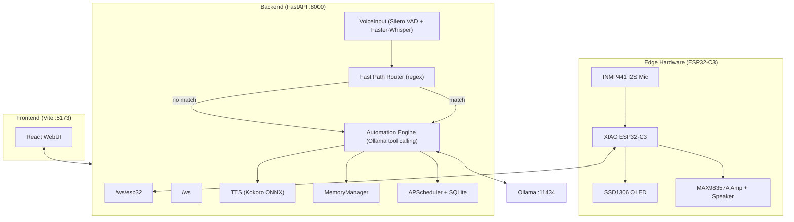

# KYOMA → AI RECEPTIONIST: MASTER PROMPT

> Save this file in the root of your new project (e.g. `PROJECT_CONTEXT.md`) and paste it at the start of every AI coding session.
> It holds the verified facts about the existing KYOMA codebase, the rules for reuse, and the build brief for the new AI Receptionist app.

---

## 0. HOW TO USE THIS FILE

1. Paste sections 1–8 as the first message in any new chat or coding-agent session.
2. Then add your task under **"CURRENT TASK"** (section 10).
3. After each work session, update section 9 (**Progress Log**) so the next session starts with correct state.

---

## 1. ROLE & RULES FOR THE AI AGENT

You are a senior engineer helping me build a **separate AI Receptionist application** using verified parts of my existing project **KYOMA**.

**Rules:**
- Do NOT build the receptionist inside the KYOMA repo. Create a new project and copy/adapt only approved modules (section 5).
- Treat everything in section 3 as ground truth. If you need something not listed, ask me instead of guessing.
- Keep STT, LLM and TTS **100% local/offline** (Whisper, Ollama, Kokoro).
- Never hardcode user paths. Anchor paths with `Path(__file__).resolve().parent`.
- Never hardcode secrets (WiFi, tokens, webhooks). Use `.env` or a secure config store.
- Do not port KYOMA desktop-automation tools (volume, brightness, screenshots, media keys, window tiling, app launcher).
- Work in small steps. After each step, tell me what changed, which files, and how to test it.

---

## 2. WHAT KYOMA IS

**KYOMA** is an offline multi-modal desktop assistant and PC automation system, adapted from the open-source **LocalAIVtuber2 (LAV 2.0)**.

It has two roles:
1. **Physical edge companion + virtual avatar**: Seeed Studio XIAO ESP32-C3 with SSD1306 OLED (animated face), plus a browser avatar (Live2D / Three.js VRM).
2. **Windows PC automation**: voice/text commands become native OS actions (volume, brightness, windows, screenshots, media keys, web search, app launch, SQLite reminders).

---

## 3. VERIFIED TECHNICAL BASELINE

| Item | Value |
|---|---|
| Original project root | `c:\Users\harsh\Downloads\LocalAIVtuber2-master\LocalAIVtuber2-master` |
| OS | Windows 10/11 64-bit |
| Language | Python 3.10+ (tested on 3.13 in `..\venv`) |
| Backend | FastAPI (Uvicorn), WebSockets, asyncio, Pydantic, Requests |
| Frontend | TypeScript 5.7, React 19, Vite 6.2, TailwindCSS v4, Radix UI, PixiJS, Three.js (`@pixiv/three-vrm`) |
| STT | Silero VAD + Faster-Whisper (`base` model, CUDA float16 / CPU int8) |
| LLM | Ollama at `http://localhost:11434` (default `gemma4:e2b` or `mistral`) |
| TTS | Kokoro ONNX (voice `af_heart`, 24 kHz WAV). GPT-SoVITS is an alternative |
| Vector memory | Qdrant (FastEmbed, all-MiniLM-L6-v2) — **not FAISS** |
| Firmware | C++ (PlatformIO/Arduino) for XIAO ESP32-C3 |
| Ports | Backend `:8000`, Frontend `:5173`, Ollama `:11434` |

**Entry points:** `start.bat` (launches Vite + FastAPI), `backend/server.py`, `Kyoma/Kyoma_automation.py` (CLI REPL), `esp32_firmware/src/main.cpp`.

### Architecture (three planes)



### Voice pipeline (verified)

1. Mic → 16 kHz, 16-bit, mono PCM, 512-sample chunks (~32 ms) into Silero VAD.
2. VAD probability ≥ 0.3 starts speech; silence > 0.1 s ends it.
3. Faster-Whisper transcribes, with a hallucination filter list.
4. **Tier 1 – Fast Path** (`fast_router.route(text)`): regex match, zero LLM, ~5–10 ms.
5. **Tier 2 – Ollama native tool calling**: system prompt + registered tools, execute tool, second round for conversational reply.
6. Kokoro synthesizes the reply (~60 ms) and sends it to the browser / host speakers / ESP32.

---

## 4. KNOWN DISCREPANCIES (DO NOT TRUST THE OLD README)

| Claim | Reality |
|---|---|
| ESP32 mic streaming | **Disabled**: `backend/server.py:256-259` is commented out. Audio comes from the **host PC mic** (`Input.py:101`) |
| ESP32 speaker output | ✅ Works (`server.py:346-353`, `989-1003`) |
| ESP32 OLED expressions | ✅ Works (`main.cpp:302-372`) |
| FAISS RAG memory | ❌ Not used. Qdrant in `Memory.py`; Kyoma automation uses a plain in-memory list |
| EdgeTTS / GPT-SoVITS active | ❌ Active engine is **Kokoro** (`settings.json: tts.provider = kokoro`) |
| ESP32 push-to-talk | ❌ Firmware streams continuously in `STATE_LISTENING`; no button check |
| Screen vision | ⚠️ `VisionInput.py` is legacy LAV, not wired to Kyoma |
| Ollama tool calling | ✅ Works (`Kyoma_automation.py:531-662`) |
| Fast path router | ✅ Works (`fast_router.py`) |
| Reminders | ✅ Works (SQLite + APScheduler + win10toast/winotify) |

---

## 5. REUSE BLUEPRINT

### A. Reuse as-is
| Module | Purpose |
|---|---|
| `backend/services/Input/Input.py` | Silero VAD + Faster-Whisper STT (deps: `faster-whisper`, `silero-vad`, `sounddevice`, `numpy`, `torch`) |
| `backend/services/TTS/Kokoro/KokoroTTS.py` | Offline TTS (deps: `kokoro-onnx`, `soundfile`, `numpy`) |
| `backend/auth.py` | Bearer-token API key generator/validator |
| `Kyoma/memory_manager.py` | In-memory sliding-window chat history |
| `backend/services/LLM/OllamaLLM.py` | Ollama streaming wrapper |
| `backend/services/TTS/TTS.py` | TTS facade / provider switch |

### B. Reuse with adaptation
| Module | Change needed |
|---|---|
| `Kyoma/fast_router.py` | Replace desktop regexes with receptionist FAQs ("Where is the restroom?", "Office hours?", "I have an appointment with…") |
| `Kyoma/Kyoma_automation.py` | Strip PC tools; register `check_visitor_appointment()`, `register_guest()`, `notify_host_slack()`, `book_conference_room()`, `lookup_directory()`; change system prompt to "Corporate AI Receptionist" |
| `Kyoma/reminder_utils.py` | Change schema to visitors / appointments / host follow-ups |
| `backend/services/Memory/Memory.py` (Qdrant) | Load employee directory, policies, floor plans for FAQ RAG |
| `backend/services/Memory/HistoryStore.py` | Store visitor interaction transcripts |
| `backend/server.py` | Keep HTTP/WS skeleton; remove VTuber logic |
| `esp32_firmware/src/main.cpp` | Optional desk robot: greeting animations, logo, QR check-in |
| `frontend/` | Replace VTuber UI with a kiosk / visitor check-in UI |

### C. Do NOT migrate
`volume_control.py`, `display_control.py`, `media_control.py`, `screenshot.py`, `app_utils.py`, `window_manager.py`, `backend/services/Character/`, `backend/services/ChatFetch/`, `VisionInput.py`.

### D. Missing pieces to build
| Gap | Recommended solution |
|---|---|
| Visitor DB | SQLite/PostgreSQL: `visitors`, `appointments`, `hosts` (name, company, host email, check-in/out, NDA status) |
| Host notifications | Slack / Teams webhook, email/SMS (Twilio/SendGrid) |
| Calendar | OAuth2 Google Workspace or Microsoft Graph |
| Wake word / presence | OpenWakeWord, or PIR/ultrasonic sensor on ESP32 |
| Kiosk UI | Touchscreen UI with check-in form and digital badge |

---

## 6. STORAGE & DATA REFERENCE

| Data | Location | Format | Sensitivity |
|---|---|---|---|
| API key | `backend/data/api_key.txt` | Plain token | ⚠️ Secret |
| Settings | `backend/settings.json` | JSON | Low |
| Ollama model config | `Kyoma/kyoma_config.json` | JSON `{"ollama_model": ...}` | None |
| Reminders DB | `Kyoma/Reminders logs/reminders.db` | SQLite | User notes |
| Reminders log | `Kyoma/Reminders logs/reminder.log` | Text | Low |
| Temp audio | `backend/services/Input/voice_recording.wav` | 16 kHz mono WAV (overwritten) | Voice snippet |
| Chat sessions | `backend/services/Memory/chat_sessions/{uuid}.json` | JSON | Dialogue |
| Vector DB | `backend/services/Memory/data/` | Embedded Qdrant | Chat embeddings |
| Kokoro models | `backend/services/TTS/Kokoro/models/` (`kokoro-v1.0.onnx`, `voices-v1.0.bin`) | Binary | None |
| ESP32 NVS | Flash (`preferences.begin("kyoma")`) | Key/value | ⚠️ WiFi SSID/password |

**Reminders schema (pattern to follow for visitor DB):**
```sql
CREATE TABLE reminders (
    id INTEGER PRIMARY KEY AUTOINCREMENT,
    title TEXT NOT NULL,
    message TEXT,
    time TEXT NOT NULL,            -- %Y-%m-%d %H:%M:%S
    status TEXT DEFAULT 'pending', -- pending | completed | cancelled
    repeat_interval TEXT DEFAULT NULL -- daily | weekly | monthly | yearly
);
```

---

## 7. KEY CODE CONTRACTS

```python
# STT
vad_model = load_silero_vad()
whisper_model = WhisperModel("base",
    device="cuda" if torch.cuda.is_available() else "cpu",
    compute_type="float16" if torch.cuda.is_available() else "int8")

# TTS
from kokoro_onnx import Kokoro
kokoro = Kokoro("backend/services/TTS/Kokoro/models/kokoro-v1.0.onnx",
                "backend/services/TTS/Kokoro/models/voices-v1.0.bin")
samples, sr = kokoro.create(text, voice="af_heart", speed=1.0, lang="en-us")

# Two-tier routing
text, handled = fast_router.route(user_query)
if handled:
    return text                      # Tier 1: instant, no LLM
response = ollama.chat(              # Tier 2: native tool calling
    model="gemma4:e2b",
    messages=memory.get_messages(system_prompt=RECEPTIONIST_PROMPT),
    tools=AVAILABLE_TOOLS,
    keep_alive="1h")
```

---

## 8. KNOWN DEFECTS TO AVOID / FIX

1. **Hardcoded user paths** (`app_utils.py:17-45`, `Kyoma_automation.py:32-45`) point to `C:\Users\harsh\...`. Use relative paths.
2. **Secrets in firmware** (`main.cpp:17-21`): WiFi SSID/password, host IP, API key in cleartext. Move to captive portal / config.
3. **No automated tests** exist. Add tests for every new module.
4. **ESP32-C3 single I2S peripheral**: switching mic ↔ speaker causes clicks/pops.
5. **Unknown tool names**: model-invented tools return "Function not found" and cause apology loops. Validate tool names and return a clear error / stop the loop.
6. **Continuous VAD in noisy lobbies** causes false triggers → needs wake word or presence sensor.

---

## 9. PROGRESS LOG (UPDATE EVERY SESSION)

| Date | What was done | Files changed | Next step |
|---|---|---|---|
| | | | |

**Decisions made so far:** _(fill in)_

---

## 10. OPEN DECISIONS (ANSWER THESE BEFORE CODING)

1. **Hardware**: Windows kiosk with host mic/speakers only, or keep the ESP32 desk robot?
2. **Audio input**: USB boundary mic on host (reuse `Input.py`) or ESP32 mic (re-enable `server.py:256-259`, handle packet loss)?
3. **Database**: standalone local SQLite, or sync with a company DB/CRM?
4. **Host notification channel**: Slack, Teams, email, SMS, or on-screen alert?
5. **Wake word / presence**: OpenWakeWord, PIR/radar sensor, or none?

---

## 11. CURRENT TASK

> _Write your task here, for example:_
> "Set up the new project folder structure, copy the Category A modules, and create a `.env`-based config. Do not add any new features yet."

**Expected output format from the agent:**
1. Short plan (max 8 bullets)
2. Files created/changed
3. Commands to run and test
4. Anything it is unsure about

---

## 12. SUGGESTED NEW PROJECT STRUCTURE

```text
ai-receptionist/
├── PROJECT_CONTEXT.md        # this file
├── .env.example
├── start.bat
├── backend/
│   ├── server.py
│   ├── auth.py               # reused
│   ├── config.py             # loads .env
│   ├── db/                   # visitors, appointments, hosts (SQLite)
│   ├── services/
│   │   ├── stt/              # from Input.py
│   │   ├── tts/              # from KokoroTTS.py
│   │   ├── llm/              # Ollama wrapper
│   │   ├── memory/           # Qdrant FAQ RAG + session history
│   │   ├── router/           # receptionist fast_router
│   │   ├── tools/            # register_guest, notify_host, lookup_directory...
│   │   └── notify/           # Slack / Teams / email
│   └── tests/
├── frontend/                 # kiosk UI
└── esp32_firmware/           # optional
```

---

*Source: consolidated from the 8-in-1 KYOMA documentation (Docs 1–4 and 6–8). Note: Document 5 (Features, Automation & Hardware Integrations) was empty in the uploaded file, so no feature-level detail from it is included.*