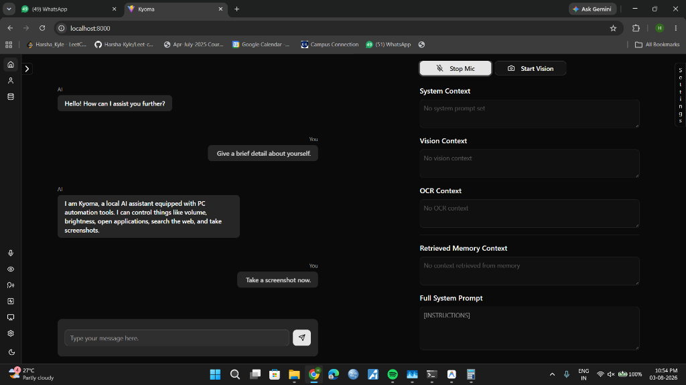
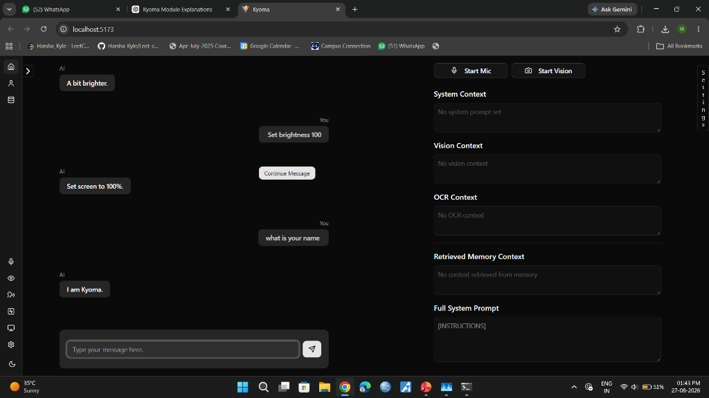
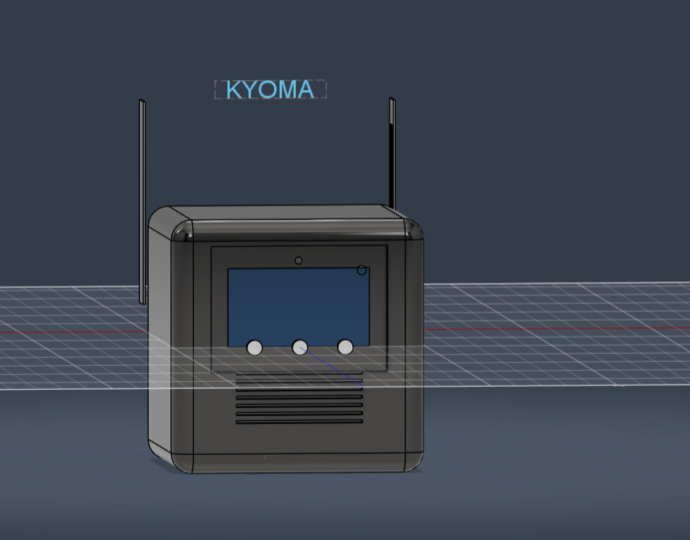
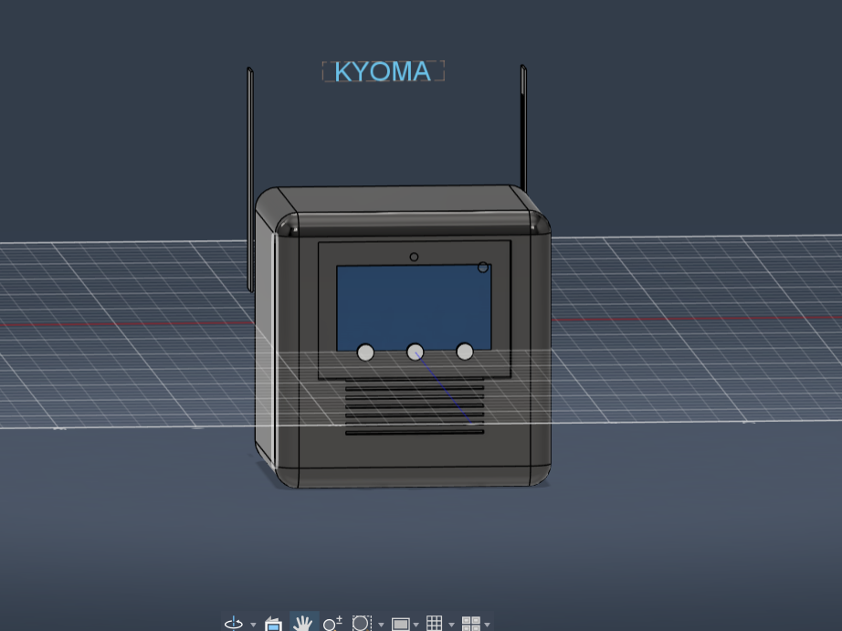
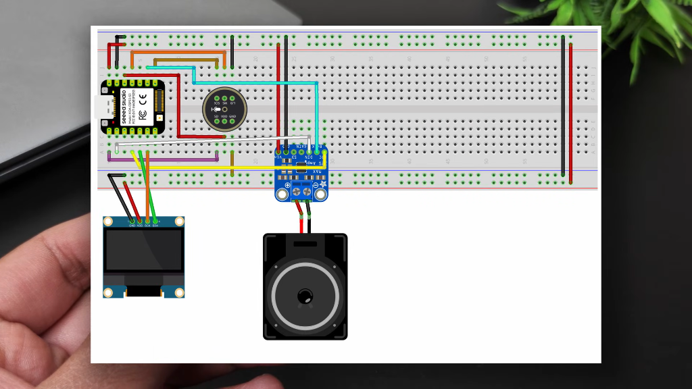
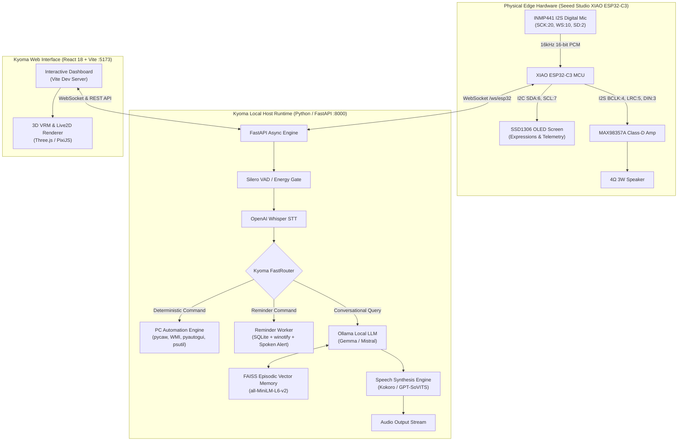

# Kyoma — Physical AI Desktop Companion & PC Automation System

<div align="center">


**Kyoma** is an offline, privacy-first physical desktop AI robot companion and voice-directed PC automation engine.

Combining physical edge hardware (ESP32-C3 microcontroller, digital I2S microphone, audio amplifier, and animated OLED display) with an end-to-end local software runtime (Whisper STT, FastRouter deterministic command execution, local LLM inference, FAISS episodic memory, and Kokoro/GPT-SoVITS TTS), Kyoma controls your operating system with near-zero latency while keeping all voice and personal data strictly on your device.

[Key Features](#key-features) • [System Showcase](#system-showcase) • [Architecture](#architecture) • [Hardware Specification](#hardware-specification) • [PC Automation](#pc-automation-capabilities) • [Getting Started](#getting-started) • [Configuration](#configuration-guide) • [Troubleshooting](#troubleshooting)

</div>

---

## Overview

Unlike cloud-dependent voice assistants that transmit audio to external servers, Kyoma is engineered from the ground up for **data sovereignty, deterministic command execution, and physical embodiment**:

1. **Sub-second Command Path (`FastRouter`)**: Routine system commands—such as volume adjustments, brightness changes, application launching, media controls, and timed reminders—bypass cloud round-trips and slow LLM generations, executing deterministically through Windows OS APIs in under 300ms.
2. **Local Conversational Intelligence**: Open-ended conversational queries, reasoning tasks, and information syntheses are routed directly to your local LLM engine (Ollama with Gemma / Mistral models) with zero external network dependencies.
3. **Physical Desktop Embodiment**: Kyoma pairs with a dedicated desk robot enclosure featuring digital I2S audio capture, synchronized OLED expressions, and bidirectional WebSocket telemetry.

---

## Key Features

- **Hands-Free Wake-Word & PTT Interaction**: Configurable between continuous wake-word monitoring (`"Hey Kyoma"` / `"Kyoma"`) with robust energy/VAD gating, and push-to-talk (PTT) operation.
- **Fast Deterministic PC Automation**: Full control over Windows audio (`pycaw`), display brightness (`screen-brightness-control`), active applications (`psutil`/`subprocess`), media playback, and filesystem navigation.
- **Natural Language Reminders**: Contextual timed reminders with dual-mode alerting—Windows desktop toasts via `winotify` and spoken voice announcements with automatic mic-mute protection.
- **Episodic Context Memory**: FAISS vector database integration powered by `sentence-transformers` embeddings, enabling recall of past user preferences and past session dialogue across restarts.
- **Real-Time Startup Diagnostics**: Synchronized pre-startup status file protocol and Vite proxy middleware that streams actual subsystem initialization metrics (VAD, STT, LLM prewarm, TTS cache) to a dedicated loading UI.
- **Low-Latency Speech Synthesis**: Native support for **Kokoro TTS** (instant neural synthesis locked to `af_heart` for zero-friction demo stability) and **GPT-SoVITS** with RVC voice cloning.
- **Live 3D & 2D Avatar Rendering**: Web UI supporting Three.js VRM 3D models and Live2D avatars synchronized with speech output.

---

## System Showcase

### Web Dashboard & PC Automation

The interactive control dashboard provides real-time visibility into active conversational turns, system subsystem health, screen vision context, and memory retrieval.

| System & Memory Context View | PC Automation & Screen Controls |
| :---: | :---: |
|  |  |

---

### Physical Hardware Enclosure

Kyoma is embodied as a compact, desktop-mounted physical robot companion. The enclosure houses digital I2S audio channels, status displays, and microcontroller hardware.

| 3D CAD Enclosure Model (Front View) | 3D CAD Enclosure Model (Side View) |
| :---: | :---: |
|  |  |

---

### Hardware Circuit & Breadboard Wiring



*Complete wiring schematic illustrating the Seeed Studio XIAO ESP32-C3 microcontroller, INMP441 I2S digital microphone, MAX98357A I2S Class-D amplifier, 4Ω 3W speaker, and SSD1306 128x64 I2C OLED display.*

---

## Architecture



---

## Hardware Specification

Kyoma communicates with an edge microcontroller using dedicated high-speed digital buses, ensuring clear voice acquisition and interference-free playback:

| Subsystem | Component | Bus / Pin Mapping | Purpose |
| :--- | :--- | :--- | :--- |
| **Microcontroller** | **Seeed Studio XIAO ESP32-C3** | Wi-Fi 2.4GHz / USB-C | Hardware coordinator and telemetry gateway |
| **Digital Microphone** | **INMP441 MEMS Microphone** | `SCK = GPIO 20`, `WS = GPIO 10`, `SD = GPIO 2` | 16kHz 16-bit mono voice acquisition |
| **Audio Amplifier** | **MAX98357A I2S Class-D** | `BCLK = GPIO 4`, `LRC = GPIO 5`, `DIN = GPIO 3` | High-efficiency audio signal amplification |
| **Speaker** | **4Ω 3W Miniature Driver** | Connected to MAX98357A output | Spoken vocal feedback and alerts |
| **OLED Display** | **SSD1306 128x64 Monochrome** | `SDA = GPIO 6`, `SCL = GPIO 7` (I2C 0x3C) | Dynamic facial expressions & connection status |

*Note: The hardware companion is optional. Kyoma can operate entirely through your PC's standard USB microphone, speakers, and the Web UI.*

---

## PC Automation Capabilities

Commands handled directly by the deterministic FastRouter execute locally with zero model latency:

| Domain | Natural Voice Example | Tool Executed | Underlying OS Subsystem |
| :--- | :--- | :--- | :--- |
| **Master Volume** | *"Set volume to 40%"* / *"Mute audio"* | `volume_set`, `volume_mute` | Windows Core Audio COM API via `pycaw` |
| **Display Brightness** | *"Increase brightness"* / *"Set brightness to 80%"* | `brightness_up`, `brightness_set` | Windows WMI / `screen-brightness-control` |
| **Applications** | *"Open Google Chrome"* / *"Close Spotify"* | `open_app`, `close_app` | `subprocess.Popen` / `psutil` process termination |
| **File Navigation** | *"Open my project directory"* | `open_folder` | Windows Explorer via `os.startfile` |
| **Media Playback** | *"Play next track"* / *"Pause music"* / *"Stop playback"* | `media_play_pause`, `media_stop` | `PyAutoGUI` virtual hardware key events |
| **Web Research** | *"Search Wikipedia for quantum computing"* | `web_search`, `search_evidence` | Python `requests` + localized scraping pipeline |
| **Screen Capture** | *"Take a screenshot of Google"* | `take_screenshot` | Timestamped desktop capture with active window detection |
| **Timed Reminders** | *"Remind me in 10 minutes to take medicine"* | `add_reminder`, `list_reminders` | SQLite queue, `winotify` toasts, and spoken alerts |

---

## Technology Stack

- **Backend Runtime**: Python 3.10+, FastAPI, Uvicorn, AsyncIO, WebSockets
- **Machine Learning & AI**:
  - LLM Inference: [Ollama](https://ollama.com/) (Gemma / Mistral)
  - Speech-to-Text: OpenAI Whisper (`base.en` / `small.en`)
  - Voice Activity Detection: Silero VAD + RMS energy gating
  - Vector Memory: FAISS (`faiss-cpu`) + `sentence-transformers` (`all-MiniLM-L6-v2`)
  - Speech Synthesis: Kokoro-82M ONNX, GPT-SoVITS, RVC v2
- **Frontend & Visuals**: React 18, TypeScript, Vite, Tailwind CSS, Three.js (`@pixiv/three-vrm`), PixiJS
- **Edge Embedded Firmware**: C++ (ESP-IDF / Arduino core for ESP32), WebSocketsClient, Adafruit GFX/SSD1306

---

## Getting Started

### System Requirements

- **Operating System**: Windows 10 / 11 (64-bit)
- **Python**: 3.10 or 3.11
- **Node.js**: v18.0+ and npm
- **GPU**: NVIDIA GPU with 6GB+ VRAM (CUDA 12.1+ recommended for real-time STT and LLM)
- **Ollama**: Installed and running locally with your desired model:
  ```powershell
  ollama pull gemma4:e2b
  # or
  ollama pull mistral
  ```

---

### Step 1: Clone the Repository

```bash
git clone https://github.com/Harsha-Kyle/KYOMA.git
cd KYOMA
```

---

### Step 2: Set Up Python Backend

```powershell
# Navigate to project root and create a virtual environment
python -m venv venv
.\venv\Scripts\activate

# Install PyTorch with CUDA acceleration (adjust for your CUDA version)
pip install torch torchvision torchaudio --index-url https://download.pytorch.org/whl/cu124

# Install backend dependencies
pip install -r backend/requirements.txt

# Initialize your local settings template
copy backend\settings.json.example backend\settings.json
```

---

### Step 3: Set Up Web Frontend

```powershell
cd frontend
npm install
cd ..
```

---

### Step 4: Download TTS Voice Weights (Optional)

If you plan to use Kokoro TTS or GPT-SoVITS:
```powershell
# Download Kokoro-82M ONNX weights and voices
python backend/download_kokoro_weights.py

# Download GPT-SoVITS base weights (if using GPT-SoVITS provider)
python backend/download_tts_weights.py
```

---

### Step 5: Launch Kyoma

Run the integrated startup launcher from the root directory:
```powershell
.\start.bat
```

The script automatically:
1. Launches the Vite development server in the background on port `5173`.
2. Opens your default web browser to the Kyoma dashboard.
3. Launches the FastAPI backend on port `8000`.
4. Streams initialization telemetry and model warmup progress until the system reports `READY`.

---

## Configuration Guide

### `Kyoma/kyoma_config.json`
Central configuration for voice interaction and fast routing:
```json
{
    "ollama_model": "gemma4:e2b",
    "demo_mode": true,
    "input_mode": "wake_word",
    "vad_silence_duration": 0.45,
    "vad_speech_threshold": 0.3,
    "whisper_initial_prompt": "KYOMA, Kyoma, brightness, volume, screenshot, reminder, battery, Notepad, Calculator",
    "reminder_speak_aloud": true
}
```

- `input_mode`: `"wake_word"` for hands-free listening, or `"push_to_talk"` for manual activation.
- `vad_silence_duration`: Silence duration (in seconds) before finalizing speech utterance (default `0.45s`).
- `reminder_speak_aloud`: Set to `true` to have reminders spoken out loud through TTS when they trigger.

### `backend/settings.json`
Stores character models, provider selections, and runtime preferences:
- `tts.provider`: Choose between `"kokoro"` or `"gpt-sovits"`.
- `tts.voice`: Default voice name (e.g., `"af_heart"` for Kokoro).
- `frontend.character.renderModel`: Enable/disable 3D VRM or Live2D character rendering.

---

## Example Commands

Once Kyoma is active, speak naturally using your microphone:

- **System Audio**:
  - *"Hey Kyoma, set volume to 50 percent"*
  - *"Kyoma, mute the audio"*
  - *"Turn the sound up"*
- **Display Brightness**:
  - *"Hey Kyoma, make the screen brighter"*
  - *"Set screen brightness to 70 percent"*
- **Applications**:
  - *"Kyoma, open Notepad"*
  - *"Open Google Chrome"*
  - *"Close Calculator"*
- **Media Playback**:
  - *"Hey Kyoma, pause the music"*
  - *"Next song"*
  - *"Stop playback"*
- **Reminders**:
  - *"Remind me in 5 minutes to submit the capstone report"*
  - *"List my active reminders"*
- **Information & Web Search**:
  - *"Who is the current Prime Minister of India?"*
  - *"Tell me about the history of quantum computing"*

---

## Privacy & Local-First Design

Kyoma adheres to a strict zero-leakage security posture:
- **Zero Cloud Audio Transmission**: Audio captured by the microphone is processed entirely in local PC memory. No raw audio or transcripts are sent to third-party APIs.
- **Local Neural Processing**: Whisper STT, Ollama LLM, and Kokoro TTS execute entirely on your GPU/CPU.
- **Credential Protection**: Firmware source code contains clean placeholders (`YOUR_WIFI_SSID`, `YOUR_API_KEY`). Real device tokens and private configuration files (`backend/settings.json`, `data/api_key.txt`, `.env`) are excluded by default via `.gitignore`.
- **Query Parameter Redaction**: Application loggers automatically filter and redact sensitive authentication tokens (`api_key=[REDACTED]`) from debug console output and Uvicorn access logs.

---

## Limitations

- **Platform Specificity**: Windows OS APIs (`pycaw`, `screen-brightness-control`, `winotify`) are currently tailored for Windows 10 and Windows 11. Linux and macOS support requires alternative automation drivers.
- **Hardware Prerequisites**: Local LLM and Whisper STT inference require a compatible NVIDIA GPU (6GB+ VRAM recommended) for real-time responsiveness.
- **Physical ESP32 Companion**: When operating without the physical ESP32 enclosure, audio capture and playback route through standard PC sound cards via the Web UI or local Python audio drivers.

---

## Troubleshooting

1. **Backend fails to start (`Connection refused` on port 8000)**:
   - Ensure Ollama is running (`ollama serve`).
   - Check if port 8000 is occupied by another process (`netstat -ano | findstr :8000`).
2. **Microphone is not transcribing audio**:
   - Check your microphone permissions in Windows Settings.
   - Verify that your input device is recognized in `backend/settings.json` or through the Web UI settings page.
3. **Vite frontend shows loading screen indefinitely**:
   - Ensure the backend console has finished initializing models. The loading screen polls `/api/startup/status` until all subsystems report ready.
4. **Reminders toast does not show**:
   - Verify that Windows Notifications and Focus Assist allow desktop toasts from Python / Kyoma.

---

## License

This project is licensed under the [MIT License](LICENSE).

---

<div align="center">

*Developed with ❤️ as part of the Kyoma Physical AI Desktop Companion Project.*

</div>
